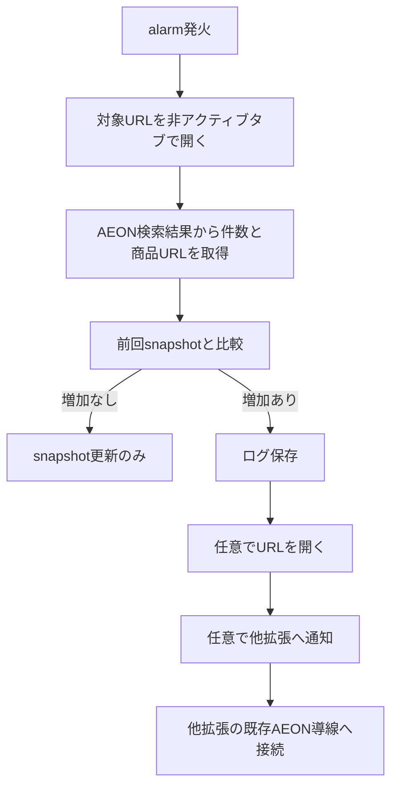

# 🎯 概要

AEON 検索結果ページの定時差分検知、ログ出力、URL オープン、外部拡張通知を行うための実装を記録する。

---

# 🧠 設計方針

* 既存の PageRecorder 単一監視設定に定時実行設定を追加する
* 定時実行は `chrome.alarms` を使い、Service Worker 再起動後も復元可能な形を採る
* 差分は前回スナップショットと比較し、AEON 検索結果ページでは商品件数と商品詳細 URL を利用する
* 他拡張連携は直接依存を避けつつ、外部メッセージ受信口を介して既存導線へつなぐ

---

# 🧩 対応要件マッピング（最重要）

requirements.md の機能要件と必ず対応付ける

| 要件 | 対応方法 |
| --- | ---- |
| 毎日指定時刻に対象 URL を確認できる可能性があること | `chrome.alarms` による daily alarm を設定する |
| 前回確認時との差分を比較し、増加を判定できる可能性があること | `storage.local` に前回 snapshot を保存して件数比較する |
| 増加検知時にログを必ず書き出せること | `downloads.download` でテキストログを書き出す |
| 増加検知時に商品 URL を開く挙動を選択できる可能性があること | popup 設定 `openDetectedUrl` を追加する |
| 他拡張機能へ検知結果を通知できる可能性があること | `chrome.runtime.sendMessage(extensionId, ...)` を使用する |
| AEON 側の既存 URL トリガーモードと連携できる可能性があること | 連携先拡張に `onMessageExternal` を追加して既存 `openExtractedUrls` へ流す |

🚨 すべての要件に対応必須
🚨 未対応要件がある場合は実装禁止

---

# 🗂 変更対象

## 新規作成

* なし

## 修正対象

* /manifest.json
* /src/background/background.js
* /src/background/monitoringConfigManager.js
* /src/ui/popup.html
* /src/ui/popup.js
* ~/Work/chromeExtensions/discord_post_url_monitor/src/background.js

## 変更なし（確認済）

* /src/handlers/aeon-handler.js

---

# 🧩 変更内容

## 対象コンポーネント

* PageRecorder background service worker
* PageRecorder popup
* discord_post_url_monitor background service worker

---

## データ構造変更

### 変更前

```json
{
  "single_config": {
    "settings": {
      "interval": 30,
      "monitorKeyword": ""
    }
  }
}
```

### 変更後

```json
{
  "single_config": {
    "settings": {
      "interval": 30,
      "monitorKeyword": "",
      "scheduleEnabled": false,
      "scheduleTime": "13:00",
      "openDetectedUrl": false,
      "notifyExternalExtension": false,
      "externalExtensionId": ""
    }
  }
}
```

---

# 🔄 処理フロー



---

# 🧩 データ構造

## 入力

```json
{
  "targetUrl": "https://aeonretail.com/Form/Product/ProductList.aspx?...",
  "scheduleTime": "13:00",
  "monitorSelector": ""
}
```

## 出力

```json
{
  "previousCount": 4,
  "currentCount": 6,
  "increaseDetected": true,
  "detectedUrls": ["https://aeonretail.com/Form/Product/ProductDetail.aspx?..."]
}
```

---

# 🌐 DOM操作（該当時のみ使用）

## 対象ページ

* URL: `https://aeonretail.com/Form/Product/ProductList.aspx?...`
* 画面名: AEON 検索結果ページ
* 前提条件: ページが通常描画され、件数表示と商品リンクが存在すること

---

## セレクタ一覧

| 対象 | セレクタ | 件数 | 検証結果 | 備考 |
| --- | ---------- | -- | ---- | -- |
| 商品詳細リンク | `a[href*='/Form/Product/ProductDetail.aspx']` | 可変 | 仮 | AEON 検索結果向け |

---

## 検証コード

```js
document.querySelectorAll("a[href*='/Form/Product/ProductDetail.aspx']").length
```

---

## 取得確認

```js
document.body?.innerText.match(/対象アイテム：\s*(\d+)\s*件/);
Array.from(document.querySelectorAll("a[href*='/Form/Product/ProductDetail.aspx']")).map(a => a.href);
```

---

## セレクタ方針

優先順位：

1. AEON 商品詳細URLパターン
2. 件数表示テキスト
3. 汎用 selector 指定

---

## 注意点

* AEON の DOM 変更で URL 抽出条件が崩れる可能性がある
* 件数表示文言が変わると正規表現の補正が必要になる

---

# ⏱ 動的DOM確認（該当時のみ使用）

## 確認事項

* 検索結果ページの描画完了後に件数表示が取得できるか
* タブ生成後の `waitForPageReady` で十分か
* リダイレクトやログイン要求が挟まらないか

---

## 待機条件

* `tabs.onUpdated` で `complete` を待つ
* 既存 `waitForPageReady` を利用する
* 固定 sleep は最小限に留める

---

# 🧩 Chrome拡張連携（該当時のみ使用）

## content script

* 役割: 今回は新規追加なし
* 実行条件: なし
* 対象ページ: なし

---

## background script

* 役割: 定時実行、snapshot比較、ログ出力、外部通知
* 入出力: popup 設定入力を受け、アラーム発火時にログと通知を出力する

---
