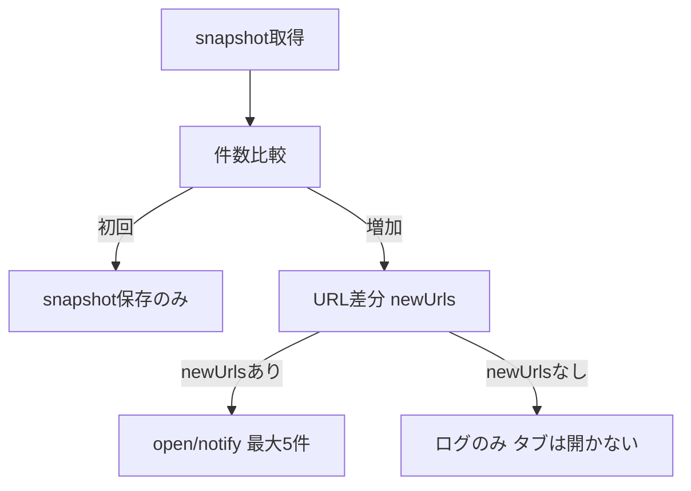

# design — AEON 一覧 商品URL収集・差分通知

## 方針

| 項目 | 変更 |
|------|------|
| 収集 | `li.product__item .product__item--name a[href*="/product/0/P-"]` を優先 |
| フォールバック | 0件時のみ `a[href*='/Form/Product/ProductDetail.aspx']` |
| 件数 | `対象アイテム：N件` テキストを優先（従来どおり） |
| 通知対象 | `normalizeStockProductUrl` 後の **新規 URL のみ**（最大5件） |

## URL 正規化

```text
https://aeonretail.com/product/0/P-xxx/P-xxx001/?foo=1
  → https://aeonretail.com/product/0/P-xxx/P-xxx001
```

## 増加検知時フロー



## 変更ファイル

- `src/background/background.js` のみ

## 手動テスト

`tests/aeon-scheduled-stock-check-sw-manual.md`

## ログ

`buildStockLogText` に `newUrls` 行を追加する。

## 移行

旧スナップショットで `urls` が空のまま件数だけ保存されている場合、URL 差分は出さない（誤って全商品を開かないため）。**1回 `runScheduledStockCheck` で基準を取り直してから** 2回目以降で差分通知する。
