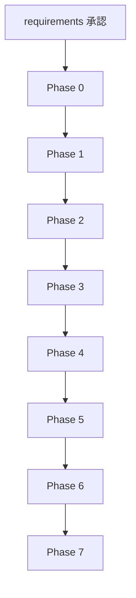

# 設計

## 概要

`plan/docs/refactor-instructions.md` を実装計画へ落とし込み、既存挙動を変えずに検証基盤是正、純粋関数テスト追加、安全な整理、限定的な構造整理、提案書化を段階的に進める。

---

## 設計方針

* 既存の定時在庫監視、外部拡張通知、storage キー、ダウンロード命名、`scheduled-watch-sites.json` スキーマは変更しない。
* 変更は Phase 単位で分離し、各 Phase 完了ごとに `npm test` と回帰確認を行う。
* まず検証基盤を正し、その後にテストを追加し、最後に構造整理へ進む。
* 高リスク項目はコード変更せず、提案書に切り出す。

---

## 対応要件マッピング

| 要件 | 対応方法 |
| --- | --- |
| 検証導線を正直な状態へ修正する | Phase 1 で `package.json` と `tests/setup.js` を整備し、`npm test` を成立させる |
| 純粋関数の安全網を用意する | Phase 2 で `tests/unit/` とテスト補助を追加し、現実装ベースの特性テストを作成する |
| 明確な死コード・不要物・実態追従ドキュメントを整理する | Phase 3 で PRD/README 系の事実追従を行い、削除は承認済み対象に限定する |
| `background.js` を挙動不変で整理しやすい形へ近づける | Phase 5 で純粋関数移設と onMessage case 抽出をロジック変更なしで実施する |
| 高リスク変更を提案止まりにする | Phase 6 で `plan/docs/refactor-proposals.md` を作成する |

---

## 変更対象

### 新規作成

* `/tests/setup.js`
* `/tests/unit/*.test.js`
* `/tests/helpers/load-background-functions.js` または同等の補助
* `/plan/refactor-baseline.md`
* `/plan/docs/refactor-proposals.md`
* `/src/background/lib/*.js`（Phase 5 の場合）

### 修正対象

* `/package.json`
* `/PRD/architecture.md`
* `/PRD/repository-structure.md`
* `/src/config/README.md`
* `/src/background/background.js`
* 必要に応じて `/tests/` 配下の手動テスト文書

### 条件付き修正対象

* `/src/background/pattern3-fix.js`（削除承認が出た場合のみ）

### 変更しないもの

* `manifest.json`
* `src/config/scheduled-watch-sites.json`
* `chrome.storage.local` のキー名と構造
* 外部拡張通知 payload 契約
* popup UI の設定項目と基本挙動

---

## Phase 設計

### Phase 0: 現状記録

* `git status`、`git log`、Node/npm 版数、`npm test` 現状、主要ファイル行数を記録する。
* 記録先は `plan/refactor-baseline.md` とする。
* 未コミット変更がある場合は停止する。

### Phase 1: 検証基盤是正

* `package.json` から実在しない script 参照を削除する。
* `tests/setup.js` を追加し、`npm test` がテスト未作成状態でも失敗しないようにする。
* `src/` 配下のランタイムコードは変更しない。

### Phase 2: 特性テスト追加

* 本体改変なしで対象関数をテスト可能にする方法を第一候補とする。
* 対象は `refactor-instructions.md` に列挙された純粋関数群と `content.js` の `normalizeText`。
* 期待値は理想仕様ではなく現実装の出力を固定する。

### Phase 3: 安全な整理

* PRD と補助ドキュメントを実態追従で更新する。
* `src/config/README.md` へバックアップ運用の正を明記する。
* 死コード削除は承認済みのものに限定する。

### Phase 4: ログ整理

* `background.js` の一時デバッグログのみを対象にする。
* `logger.debug` へ寄せる場合も、抑制ロジックに使う文字列は変えない。
* `popup.js` は logger 基盤がなければ対象外とする。

### Phase 5: 構造整理

* 純粋関数群は責務別ファイルへカット&ペーストで移設する。
* `background.js` の onMessage switch は、case ごとに名前付き関数へ抽出する。
* Phase 2 のテストは、必要なら分割後ファイルを直接参照する構成へ切り替える。

### Phase 6: 提案書化

* 統合、廃止、manifest 修正、content script 削除、webhook ローテーションなどは実装せず提案書へ整理する。
* 各提案には、メリット、リスク、検証方法、人間判断ポイントを含める。

### Phase 7: 仕上げ

* Phase ごとの結果、未実施手動テスト、残課題を整理して最終報告へ繋ぐ。

---

## データ構造変更

データ構造は変更しない。変更対象は、テスト資産、補助ドキュメント、純粋関数の配置、case 分割などのコード構造に限定する。

維持対象:

```json
{
  "storageKeys": [
    "monitoring_config",
    "scheduledStockSnapshots",
    "scheduledStockLogs",
    "scheduledStockWatchSession",
    "scheduledWatchSessions"
  ],
  "externalMessageContract": "変更なし",
  "scheduledWatchSitesSchema": "変更なし"
}
```

---

## 処理フロー



---

## Chrome拡張連携

### content script

* `content.js` は原則変更せず、`normalizeText` のテスト対象として扱う。
* manifest の `content_scripts` 構成は維持する。

### background script

* 監視・通知・保存・アラーム処理の現挙動を維持したまま、検証基盤と構造を整理する。
* `chrome.storage.local` キー、外部通知 payload、ダウンロードファイル命名、`self.*` エクスポートは維持する。

### popup / config

* popup UI の挙動や設定項目は変更しない。
* `MonitoringConfigManager` の保存構造も変更しない。

---

## テスト方針

* 各 Phase 完了時に `npm test` を実行する。
* 可能なら拡張を読み込み、Service Worker コンソールの構文エラーや `importScripts` 失敗がないことを確認する。
* Phase 5 完了時は、系統Cの baseline 保存、tick 動作、通知導線の回帰確認を既存手順書ベースで確認する。
* 実施できない手動テストは未実施として明記し、人間向け手順を残す。

---

## 注意点

* 実装開始前に、作業ブランチ命名を `refactor/` 系へ揃える要否を確認する。
* 300行を超える大きな差分になりそうな場合は、Phase をさらに分割する。
* 仕様疑義や運用判断が必要な項目は、実装で吸収せず停止して確認する。
