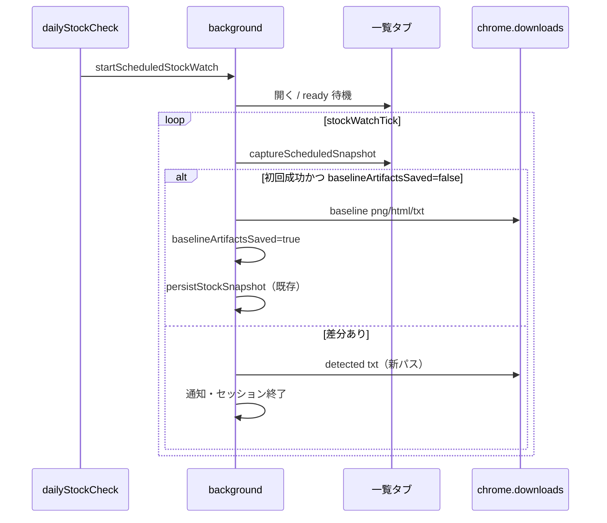

# design — baseline 取得時にスクショ＋ログを残す

## 🎯 概要

定時監視セッション **開始日ごとに1回**、AEON 一覧の baseline 証跡（PNG / HTML / txt）を `download/` 配下に保存する。検知成功時ログも **同じフォルダ・同じ項目構成** に揃え、日次比較可能にする。

---

## 🧠 設計方針

1. **ルート名 `download/` を維持**し、サブフォルダのみ整理（PRD / README / `.gitignore` との整合）。
2. **popup の downloadScreenshot / downloadSource 設定とは独立**（定時 AEON baseline 専用パス）。
3. 既存 `executeBaselineDownload` / `generateFilename` の **JST 時刻処理** を参考にしつつ、定時監視用に **専用パス生成関数** を追加（通常監視のファイル名規則と混在しない）。
4. baseline は **セッション1回のみ**。毎 tick 保存しない。
5. 検知ログは既存 `saveScheduledStockLog` を拡張し、**パス・logType のみ統一**（本文フォーマットは比較可能な項目を揃える）。

---

## 🧩 対応要件マッピング

| 要件 | 対応方法 |
|------|----------|
| FR-1 毎日 baseline 証跡 | `runStockWatchTick` 内、初回 `captureScheduledSnapshot` 成功後に `saveScheduledStockBaselineArtifacts()` を1回呼ぶ（フラグ `session.baselineArtifactsSaved`） |
| FR-2 保存パス | `buildAeonStockDownloadPath()` で `download/aeon/stock/{yyMMdd}/` を生成 |
| FR-3 検知ログ比較 | `saveScheduledStockLog` の保存先を同フォルダ・`detected_` プレフィックスに変更。共通フィールドを baseline txt と揃える |
| FR-4 popup 非連動 | 定時専用処理。`settings.downloadScreenshot` / `downloadSource` は参照しない |

---

## 📁 保存パス・命名規則

### ルート構成

Chrome `downloads.download` の `filename`（ユーザーのダウンロードフォルダからの相対パス）:

```text
download/
└── aeon/
    └── stock/
        └── {yyMMdd}/          ← JST の日付フォルダ（例: 260601）
            ├── baseline_{yyMMdd-hhmmss}.png
            ├── baseline_{yyMMdd-hhmmss}.html
            ├── baseline_{yyMMdd-hhmmss}.txt
            └── detected_{yyMMdd-hhmmss}.txt   ← 検知成功時のみ
```

### タイムスタンプ

| 要素 | 形式 | 例 | タイムゾーン |
|------|------|-----|-------------|
| 日付フォルダ `{yyMMdd}` | **2桁年** + 月 + 日（`yy` = 西暦下2桁。4桁年 `YYYY` は使わない） | `260601` | JST |
| ファイル名 `{yyMMdd-hhmmss}` | **2桁年** + 月日 + `-` + 時分秒 | `260601-115700` | JST |

> **注意:** `hh` は24時間制。秒は2桁（`00`〜`59`）。

### サブフォルダ（固定）

| 階層 | 値 | 備考 |
|------|-----|------|
| 1 | `download/` | ルート（変更しない） |
| 2 | `aeon/` | サイト識別（固定） |
| 3 | `stock/` | 定時在庫監視用（固定） |
| 4 | `{yyMMdd}/` | JST 日付（2桁年） |

フルパス例: `download/aeon/stock/260601/baseline_260601-115700.png`

### 種別プレフィックス

| プレフィックス | 用途 |
|----------------|------|
| `baseline_` | 監視開始日の初回 snapshot 成功時（PNG / HTML / txt） |
| `detected_` | 差分検知成功時（txt のみ。既存通知・storage 更新は維持） |

### リポジトリ `./download/` との関係

- リポジトリの `./download/` は gitignore 対象の **手動整理用** サンプル置き場。
- 実行時保存先は Chrome ダウンロードフォルダ配下だが、**相対パス規約を `download/aeon/stock/...` で統一**する。
- 開発者が repo の `./download/aeon/stock/` に手動コピーして整理してもよい（任意）。

---

## 📄 ログ形式（比較用）

### baseline txt（`baseline_{yyMMdd-hhmmss}.txt`）

```text
PageRecorder Scheduled Stock Log
logType: baseline
timestamp: {ISO8601}
targetUrl: {一覧URL}
comparisonKey: {normalized key}
count: {対象アイテム件数}
urlCount: {urls配列長}
usedSelector: {セレクタ}
title: {document.title}
urls:
{url1}
{url2}
...
textPreview: {先頭2000文字}
```

### detected txt（`detected_{yyMMdd-hhmmss}.txt`）

baseline と **同一キー** を先頭に置き、検知固有項目を追加:

```text
PageRecorder Scheduled Stock Log
logType: detected
timestamp: ...
targetUrl: ...
comparisonKey: ...
previousCount: ...
currentCount: ...
count: {currentCount と同値}
urlCount: {detectedUrls.length}
usedSelector: ...
increaseDetected: true
newUrls:
...
detectedUrls:
...
title: ...
textPreview: ...
```

→ 同一 `{yyMMdd}` フォルダ内の `baseline_*` と `detected_*` を diff / 目視比較可能。

---

## 🔄 処理フロー



### baseline 保存タイミング（確定）

| 条件 | 保存するか |
|------|------------|
| 監視セッション開始日（毎日 `dailyStockCheck`） | **はい**（1回） |
| `scheduledStockSnapshots` が空 | 関係なく保存 |
| 2回目以降の tick | **いいえ** |
| 手動 `startScheduledStockWatch`（テスト） | **はい**（同上） |

---

## 🗂 変更対象

### 新規（background.js 内）

- `formatJstStockTimestamp(date)` → `{ yyMMdd, yyMMdd_hhmmss }`
- `buildAeonStockDownloadPath(kind, date)` → `download/aeon/stock/{yyMMdd}/{kind}_{yyMMdd-hhmmss}.{ext}`
- `buildBaselineLogText(snapshot, session)` 
- `saveScheduledStockBaselineArtifacts(session, snapshot, tabId)`

### 修正

- `runStockWatchTick` — 初回 snapshot 成功後に baseline 保存 + セッションフラグ
- `saveScheduledStockLog` / `buildStockLogText` — 新パス・`logType: detected`・比較用フィールド
- `scheduledStockWatchSession` — `baselineArtifactsSaved: boolean`（任意）

### ドキュメント

- `tests/aeon-scheduled-stock-check-sw-manual.md` — 保存先確認手順

### 変更なし

- popup UI（新規設定項目なし）
- `monitoringConfigManager` の `downloadScreenshot` デフォルト
- discord 連携メッセージ形式

---

## 🧪 テスト方針

### 手動

1. 監視終了を未来に設定 → `startScheduledStockWatch()`
2. Chrome ダウンロードフォルダで `download/aeon/stock/{今日yyMMdd}/` を確認
3. `baseline_*.{png,html,txt}` が1セット存在
4. baseline 減らし → 再開始 → `detected_*.txt` が **同じ日付フォルダ** に追加
5. popup「スクリーンショット」OFF でも baseline 3ファイルが保存されること

---

## ⚠️ リスクと対策

| リスク | 対策 |
|--------|------|
| スクショ時のタブ activate で UX 干扰 | 取得後すぐ非アクティブ化（可能なら） |
| 同一秒内に baseline + detected | 秒精度タイムスタンプ + 種別プレフィックスで衝突回避 |
| 旧パス `PageRecorder/stock_logs/` 参照 | 手順書・memo を新パスに更新 |

---

## 🔀 代替案

| 案 | 内容 | 採否 | 理由 |
|----|------|------|------|
| A | 既存 `PageRecorder/stock_logs/` 維持 | ❌ | baseline との日次比較がしづらい |
| B | `download/aeon/stock/{yyMMdd}/` + `baseline_` / `detected_` | ✅ | ユーザー決定・PRD 整合 |
| C | popup downloadScreenshot 連動 | ❌ | ユーザー決定（連動不要） |

---

## 📝 承認

* [x] ユーザー承認済み
