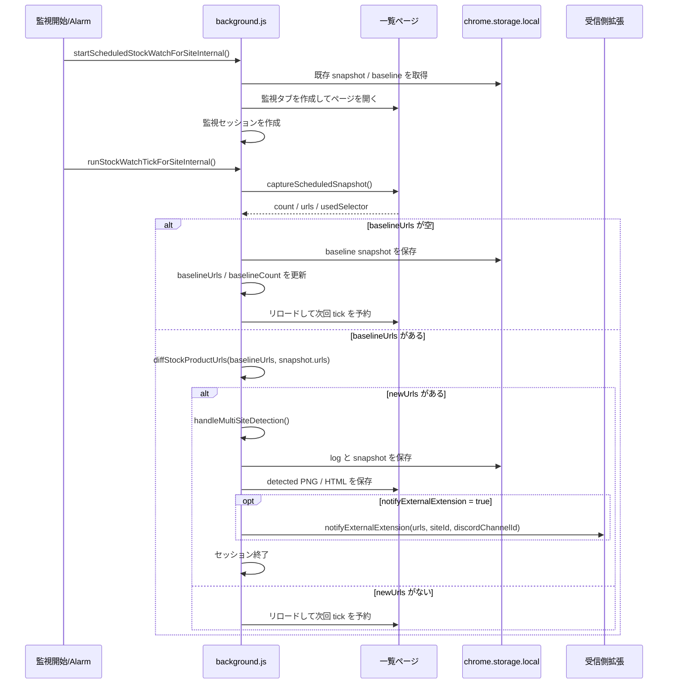

# design — 新商品URL自動取得

## ステータス

ドラフト。requirements 承認前の実装は禁止。

## 方針

新規の監視系統は増やさず、既存の複数サイト定時監視フローを使って新商品URL自動取得を成立させる。

対象フロー:

1. `startScheduledStockWatchForSiteInternal()`
2. `runStockWatchTickForSiteInternal()`
3. `captureScheduledSnapshot()`
4. `diffStockProductUrls()`
5. `handleMultiSiteDetection()`
6. `notifyExternalExtension()`

## シーケンス図

## 設計判断

### 1. 設定入口は `scheduled-watch-sites.json` に限定する

- URL抽出対象は `selectors.productLinks` を正本とする
- 件数取得は `selectors.itemCount` を使い、未設定時は既存フォールバックを使う
- popup / storage に新しい設定項目は追加しない

### 2. URL抽出は既存の `captureScheduledSnapshot()` をベースに整理する

- `productLinks` がアンカー自体を指す場合はその `href` を使う
- 商品カード要素を指す場合は、配下の代表商品リンクを1件だけ使う
- URL集合は重複排除してスナップショットへ保存する
- サイト固有の特例は最小限に留め、`scheduled-watch-sites.json` のセレクタで吸収する方針を優先する

### 3. 差分判定は「新規URLのみ」を基準にする

- ベースライン `baselineUrls` と今回取得 `snapshot.urls` を比較する
- `newUrls.length > 0` のときだけ新商品検知として扱う
- 件数増減は補助情報としてログに残すが、通知トリガーは URL 差分を優先する

### 4. 検知後処理は既存出口を維持する

- 検知時の PNG / HTML 保存は既存どおり実行する
- 外部拡張通知の payload は既存の `urls` / `siteId` / `discordChannelId` を維持する
- `PageRecorder` は通知先決定までは持たず、新規URL抽出までを責務とする

## 変更対象候補

- `src/background/background.js`
- `src/config/README.md`
- `tests/` 配下の手動テスト文書

## 保留・未採用

- `Content Script` を使った別系統の一覧監視追加: 今回は対象外
- popup の抽出URL表示UI: 今回は保留
- 抽出URLの自動監視登録: 今回は保留

## 確認観点

- `selectors.productLinks` がアンカー型・カード型の両方で期待どおり URL を拾えるか
- 初回ベースライン保存時は通知せず、2回目以降の `newUrls` のみ通知されるか
- 外部拡張通知に渡る `urls` が一覧ページURLではなく商品URL集合になっているか
