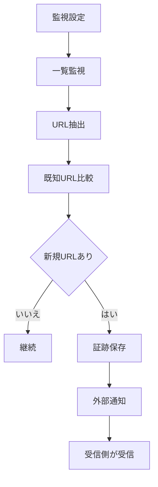

# requirements — 新商品URL自動取得

## ステータス

ドラフト。`design.md` / `tasks.md` とあわせて承認待ち。

## 起点

- `plan/todo.md` の `新商品URL自動取得`
- `plan/docs/missing-features-roadmap.md`
- `PRD/system-role-definition.md`

## 背景

`PageRecorder` は情報収集フェーズの担当として、複数サイト定時在庫監視と外部拡張通知をすでに持っている。
一方で、パターン B / D の「一覧ページで新商品を検知し、商品URLを次段へ渡す」責務は、ロードマップ上は未実装扱いのままで整理が不十分になっている。

現状コードには、`scheduled-watch-sites.json` の `selectors.productLinks` を使った URL 抽出、ベースライン保存、URL 差分検知、external messaging の土台が一部存在する。
今回のタスクでは、この既存導線を前提に「新商品URL自動取得」を正式な実装対象として定義し直す。

## 目的

一覧ページ監視で新規に出現した商品URLだけを自動抽出し、`PageRecorder` の既存検知フローで保存・通知できる状態にする。

## アクティビティ図

## 今回スコープ

1. `scheduled-watch-sites.json` ベースの複数サイト定時監視で、新商品URL抽出の要件を明文化する
2. 既知URLとの差分比較により、新規URLのみを検知対象にする
3. 検知時の保存・ログ・外部拡張通知は既存フローを維持しつつ、新規URL中心に扱う
4. 実装後に必要となる手動テスト観点と設定前提を整理する

## 今回スコープ外

- popup からの新商品URL抽出設定UI追加
- 抽出URLの自動監視登録
- 通知先ルーティングの最適化
- 受信側拡張 (`main_discord_post_url_monitor` / `AutoCartAgent`) の仕様変更
