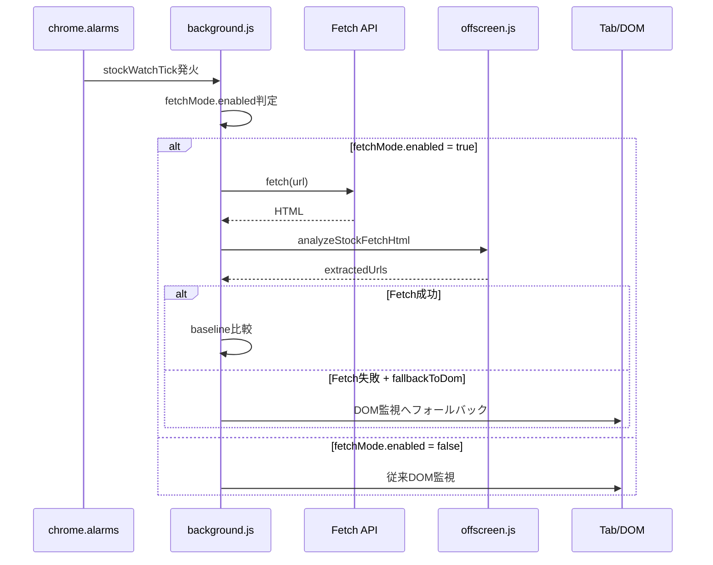

# design.md

## 🎯 概要

requirements.md を満たすための
**具体的な実装方法（How）を定義する**

---

## 🛠 技術スタック

- **Manifest Version**: V3
- **対象ブラウザ**: Chrome 120+
- **主要API**:
  - chrome.runtime
  - chrome.storage
  - chrome.scripting
  - chrome.alarms
  - Fetch API
- **外部依存**: なし
- **ビルドツール**: なし（vanilla JS）

---

## 📁 ディレクトリ構造

```
src/
├── background/       # Service Worker - Fetch監視ロジック追加
├── config/           # scheduled-watch-sites.json - fetchModeフィールド追加
├── offscreen/        # offscreen.js - URL抽出モード追加
└── ui/               # popup.js - 診断結果反映UI追加
```

---

## 🧠 設計方針

## 仕様更新（2026-09-25）

- popup の単一URL監視・複数URL監視には共通設定として `captureMode`（`fetch` / `reload`）を保存する。
- 定時複数サイト監視は、サイトカードごとの選択を `scheduledWatchOverrides` の `fetchMode.enabled` に保存する。
- A系高頻度Fetchは監視タブのContent Scriptで同一URLをFetchし、タブを再読込せずに既存の5〜20秒間隔で継続する。
- A系通常監視はContent ScriptへFetch状態取得を要求する。C系Fetchは既存どおりService Workerとoffscreenでタブレス取得する。
- Fetch検知は直ちに既存通知処理へ渡し、PNG・HTML・AI判断サポートの証跡取得時だけ監視タブを再読込する。
- Fetch通信・HTML解析・Content Script通信の失敗時は、そのセッションをリロード方式へ切り替えて継続する。
- 一括Fetch診断は確認用途に限定し、結果から方式設定を自動変更するボタン・メッセージは廃止する。
- `monitoringExecutionHistory` を `chrome.storage.local` に保存し、対象ごとに実行中または直近1実行の全チェック履歴を保持する。
- popupは専用メッセージで履歴を取得し、実行中だけ1秒ごとに再表示する。`getStatus` の応答サイズには履歴を含めない。

### 方針1: 既存動作維持優先

- `fetchMode` がない/無効なサイトは従来通りDOM監視
- デフォルトで `fetchMode.enabled: false`
- `fallbackToDom: true` で安全側に倒す

### 方針2: 静的JSON制約の回避

- `scheduled-watch-sites.json` は静的ファイルのため直接更新不可
- `chrome.storage.local` に `scheduledWatchOverrides` を保存
- 設定読み込み時にマージ

### 方針3: 既存offscreen活用

- 既存の `analyzeStockFetchHtmlWithOffscreen` を拡張
- URL抽出モードを追加

---

## 🧩 対応要件マッピング（最重要）

| 要件 | 対応方法 |
| ---- | -------- |
| fetchModeフィールド追加 | scheduled-watch-sites.jsonスキーマ拡張 + オーバーライド機構 |
| Fetch監視ロジック | captureScheduledSnapshotViaFetch関数追加 |
| DOM監視との分岐 | runMultiSiteTickInternal内で fetchMode.enabled 判定 |
| フォールバック | try-catch + fallbackToDom判定 |
| 取得方式選択UI | popupのselect + 設定保存メッセージハンドラ |

---

## 🗂 変更対象

### 新規作成

- なし（既存ファイルへの追加で対応）

### 修正対象

- `/src/config/scheduled-watch-sites.json` - fetchModeフィールド追加
- `/src/background/background.js` - Fetch監視関数、分岐ロジック
- `/src/offscreen/offscreen.js` - URL抽出モード追加
- `/src/ui/popup.js` - 診断結果反映UI

### 変更なし（確認済）

- `/src/content/content.js` - 系統A用、今回対象外
- `/manifest.json` - 権限追加不要

---

## 🧩 変更内容

### 対象コンポーネント

1. **scheduled-watch-sites.json**: fetchModeフィールド追加
2. **background.js**: Fetch監視関数、分岐ロジック、オーバーライド機構
3. **offscreen.js**: URL抽出モード追加
4. **popup.js**: 診断結果反映UI

---

### データ構造変更

#### 変更前

```json
{
  "id": "example-site",
  "name": "Example",
  "enabled": true,
  "url": "...",
  "selectors": {...}
}
```

#### 変更後

```json
{
  "id": "example-site",
  "name": "Example",
  "enabled": true,
  "url": "...",
  "selectors": {...},
  "fetchMode": {
    "enabled": false,
    "fallbackToDom": true,
    "diagnosisCode": null,
    "lastDiagnosedAt": null
  }
}
```

---

## シーケンス図



---

## 🧩 データ構造

### 入力: オーバーライド設定

```json
{
  "scheduledWatchOverrides": {
    "site-id": {
      "fetchMode": {
        "enabled": true,
        "fallbackToDom": true,
        "diagnosisCode": "FETCH_SUPPORTED",
        "lastDiagnosedAt": "2026-09-25T14:40:00Z"
      }
    }
  }
}
```

### 出力: Fetch監視結果

```json
{
  "urls": ["https://example.com/product/1", "..."],
  "count": 5,
  "usedSelector": "li.product__item",
  "fetchMode": true,
  "fetchStatus": 200
}
```

---

## 🧩 Chrome拡張連携

### background script

- 役割: Fetch監視実行、分岐判定、オーバーライド管理
- 入出力: alarm発火 → Fetch/DOM判定 → snapshot返却

### offscreen

- 役割: Fetch HTML解析、URL抽出
- 入出力: HTML文字列 → 抽出URL配列

### popup

- 役割: 監視モードごとの取得方式選択と設定保存
- 操作起点: 単一URL・複数URLの共通select、定時複数サイトのサイト別select

### メッセージ連携

| 送信元 | 送信先 | 内容 |
| ------ | ------ | ---- |
| popup | background | updateScheduledWatchCaptureMode |
| background | offscreen | analyzeStockFetchHtml (URL抽出モード) |

---

## ⚠️ 影響範囲

- 関連機能: 定時在庫監視（系統C）
- 関連ファイル: background.js, offscreen.js, popup.js
- UIへの影響: popup監視設定に取得方式selectを追加
- 外部依存: なし

---

## 🧪 テスト方針

### 手動テスト

1. FETCH_SUPPORTEDサイトでFetch監視が動作すること
2. Fetch失敗時にDOM監視へフォールバックすること
3. 選択した取得方式が保存・再表示されること
4. fetchMode未設定サイトが従来通り動作すること

### 自動テスト

- 対象: captureScheduledSnapshotViaFetch関数
- 方針: モックfetch応答でのURL抽出テスト

---

## 🚧 リスクと対策

| リスク | 対策 |
| ------ | ---- |
| Fetch失敗 | fallbackToDomでDOM監視へ |
| 診断精度不足 | 診断結果は参照のみ。取得方式は利用者が選択する |
| オーバーライド競合 | マージ時にオーバーライド優先 |

---

## 🔀 代替案

| 案 | 内容 | 採否 | 理由 |
| --- | ---- | ---- | ---- |
| A | JSONファイル直接編集 | ❌ | 静的ファイルのため不可 |
| B | storage.localでオーバーライド | ✅ | 動的更新可能 |
| C | 別設定ファイル作成 | ❌ | 管理複雑化 |

---

## ❓ 未確定事項

- スクリーンショット保存: Fetch監視成功時は検知時のみタブ生成で対応
- マージ順序: 基本設定 → オーバーライド の順で上書き

---

## 📝 decisions.md記録対象

- D-001: オーバーライド方式の採用理由

---

## 📝 承認

- [x] ユーザー承認済み

---

## 🚨 実装ルール（最重要）

- 本design.mdに記載された内容のみ実装可能
- 未記載仕様の実装は禁止
- 不明点は requirements / decisions に戻る

---

## 🎯 最終原則

👉 requirementsを100%満たす
👉 実装方法を曖昧にしない
👉 迷ったら実装しない
