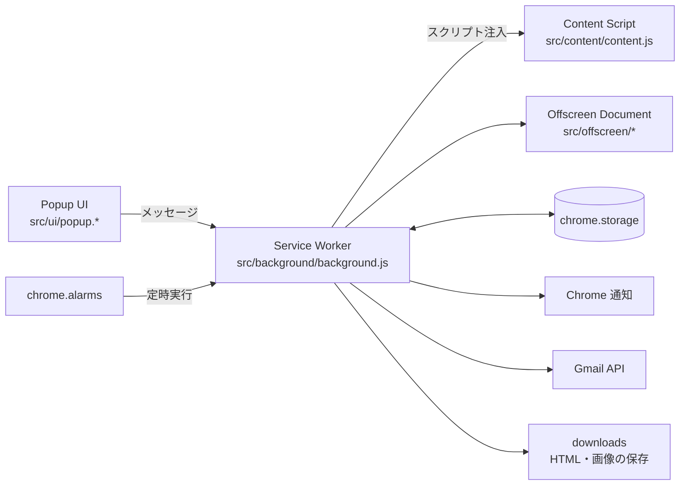

# PageRecorder

Webページの変化を検知・記録し、通知する Chrome 拡張機能です（Manifest V3）。

---

## このプロジェクトについて

自分の業務で、複数の Web サイトを開いて更新し、変化を目で確認する作業に毎日数時間かかっていました。この作業を自動化するために作った拡張機能です。

- 指定したページを定期的にチェックし、キーワードの出現・消失やページ内容の変化を検知します
- 検知したときのページの HTML とスクリーンショットを保存し、Chrome 通知とメールで知らせます
- 導入後は、確認作業が1日約3時間から1時間以内になりました（約7割削減）

個人で企画・設計・実装・テストまで行い、日常業務で運用しながら改善を続けています。

---

## 主な機能

| 機能 | 内容 |
|------|------|
| ページの記録 | 開いているタブまたは指定 URL の HTML（DOM の outerHTML）とスクリーンショットを保存 |
| キーワード監視 | 単一 URL・複数 URL を対象に、指定キーワードの出現・消失を一定間隔でチェック |
| 定時チェック | `chrome.alarms` で指定時刻に複数サイトをチェックし、前回との差分を検知 |
| 通知 | Chrome 通知、Gmail API によるメール通知、他の拡張機能へのメッセージ通知 |
| 実行履歴 | チェック時刻・実測間隔・取得結果を popup で確認 |
| 取得方式の診断 | Fetch で取得した HTML と表示後の DOM を比較し、サイトごとに適した取得方式を調べる |
| 設定のバックアップ | 監視設定を JSON で書き出し・取り込み（認証情報や実行状態は含めない） |
| ログ | ERROR / INFO / DEBUG を popup で切り替え。監視結果を Markdown で保存する機能あり |

---

## 構成



- **Manifest V3 の制約への対応**: Service Worker は停止・再起動されるため、監視状態は `chrome.storage` に保存し、`chrome.alarms` で処理を再開します
- **責務の分離**: 監視ロジック、background の入出力、外部への通知を分けて実装しています
- **設定**: サイトごとの監視条件は `src/config/*.json` にまとめています

主なディレクトリ:

```text
src/
├── background/   # Service Worker と監視処理
├── content/      # ページ内で動くスクリプト
├── offscreen/    # Offscreen Document
├── ui/           # popup
├── lib/          # ログ・通知・ファイル保存などの共通処理
└── config/       # 監視対象サイトの設定
tests/            # Jest のテストと手動テスト手順書
PRD/              # 要件・設計・用語集
.steering/        # タスクごとの要件・設計・作業記録
```

---

## テスト

- テストフレームワーク: Jest（`jest-chrome` で Chrome API をモック）
- テストファイル 20 本、テストケース 394 件
- ネットワークに依存しないよう、テスト用の模擬ECサーバー（`tests/fake-ec/`）を用意しています
- 自動テストで確認しにくい画面操作は、手順書（`tests/docs/`）に沿って手動で確認しています

```bash
npm ci --legacy-peer-deps
npm test
```

`jest-chrome` が古い Jest を peer dependency に指定しているため、`--legacy-peer-deps` を付けてインストールします。

作者の環境にあるファイルを読むテストは、そのファイルが無い環境では自動でスキップされます。

---

## 開発の進め方

機能追加や修正は、次の流れで進めています。

```text
PRD（プロダクト全体の要件・設計）
  └→ requirements.md（今回の要件・受け入れ条件）
       └→ design.md（実装方法・影響範囲・テスト方針）
            └→ tasks.md（Phase ごとの作業と確認項目）
                 └→ 実装 → テスト → 完了記録
```

- タスクごとの記録は `.steering/` にあります（完了分は `.steering/done/`）
- 作業はブランチで行い、要件・設計の承認を得てから実装します
- 生成AI（Claude Code・Codex など）を、設計の壁打ち、実装、テスト作成、ドキュメント整備に活用しています。AI 向けの作業ルールは `CLAUDE.md`・`AGENTS.md`・`.claude/` にあります

---

## セットアップ

1. このリポジトリをダウンロードする
2. Chrome で `chrome://extensions` を開き、「デベロッパーモード」をオンにする
3. 「パッケージ化されていない拡張機能を読み込む」でこのフォルダを選ぶ

### Gmail 通知を使う場合

`manifest.json` の OAuth クライアントIDはプレースホルダー（`YOUR_CLIENT_ID`）になっています。

1. Google Cloud Console でプロジェクトを作り、Gmail API を有効にする
2. 「OAuth クライアントID」を「Chrome 拡張機能」の種類で作成し、拡張機能の ID を登録する
3. `manifest.json` の `oauth2.client_id` を、作成したクライアントIDに書き換える

Gmail 通知を使わない場合は、この設定なしで他の機能を利用できます。

### 補足

- `scripts/` には作者の環境向けの補助スクリプトが含まれています。パスは作者の環境を前提にしています
- `docs/`・`.steering/` の一部の文書は、作者の環境での運用を前提に書かれています

---

## ライセンス

[MIT License](LICENSE)
