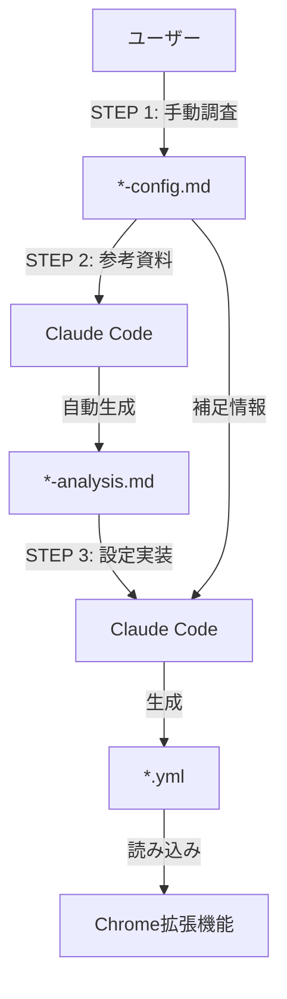

# サイト構造分析ファイル管理

## 📋 概要
このディレクトリは、監視対象サイトの構造分析資料と設定メモを管理します。各サイトごとに `*-config.md`（簡易メモ）と `*-analysis.md`（詳細分析）の2種類のファイルを作成し、最終的に`../user-site-configs/*.yml`（実装設定）を生成します。

### 3つのファイルの関係性
```
*-config.md (人間用メモ)
    ↓ 参照
*-analysis.md (人間用分析)  → Chrome拡張機能は読み込めない（Markdown形式）
    ↓ 統合
*.yml (機械用設定)          → Chrome拡張機能が読み込んで実行（YAML形式）
```

**重要**: `*-config.md`と`*-analysis.md`は**人間が読むための文書**です。Chrome拡張機能はMarkdownを読み取れないため、**`.yml`ファイルが実行に必須**です。

---

## 📁 ファイル構成パターン

```
docs/examples/structures/
├── Chocolate Inc監視構造分析.md (6.7KB)    - 詳細分析資料
├── Chocolate Inc監視設定メモ.md (936B)     - 設定メモ
├── POPMART再入荷監視構造分析.md            - 詳細分析資料
├── POPMART再入荷監視設定メモ.md            - 設定メモ
├── Sonny Angel監視設定メモ.md              - 設定メモ
└── サイト構造分析テンプレート.md           - 分析テンプレート
```

---

## 📝 ファイルタイプ別説明

### 1. `*-config.md` - 簡易設定メモ（ユーザー作成）

#### 目的
- **クイックリファレンス**
- **実際のDOM要素記録**
- **ID変更履歴の追跡**

#### 作成者
**ユーザー**（手動調査・F12での分析結果）

#### 内容例
```markdown
## トップ
https://shop.chocolate-inc.com/pages/sunsun

## カートに追加する
<button id="ProductSubmitButton-template--20131086794970__main"...>
  <span>カートに追加する</span>
</button>

## 同じページでも、idは変更になる?
#ProductSubmitButton-template--19719530741978__main
↓ 2025/09/24時点
ProductSubmitButton-template--20131086794970__main
```

#### 特徴
- **36行程度の簡潔メモ**
- 実際のDOMコピペ
- 変更追跡のみ
- 技術的解説なし

---

### 2. `*-analysis.md` - 詳細分析資料（Claude Code作成）

#### 目的
- **サイト構造の徹底分析**
- **監視設定の技術的根拠**
- **トラブルシューティング情報**

#### 作成者
**Claude Code**（`*-config.md` を参考に自動生成）

#### 内容構成
```markdown
✅ サイト基本情報（URL、プラットフォーム、地域）
✅ UI構造分析（監視対象要素、状態変化パターン）
✅ DOM構造（実際のHTMLコード）
✅ セレクター分析（推奨・代替・避けるべきセレクター）
✅ 検証コード（JavaScript実行可能コード）
✅ 設定推奨値（監視間隔・検知モード・停止条件）
✅ 注意事項（技術的制約、サイト固有特徴）
✅ 実装例（完全な.yml設定）
✅ トラブルシューティング（よくある問題と解決策）
```

#### 特徴
- **194行程度の詳細ドキュメント**
- JavaScript検証コード付き
- セレクター変更履歴記録
- プラットフォーム固有の技術的注意事項

---

### 3. `*.yml` - 実装設定ファイル（Claude Code作成 → Chrome拡張機能使用）

#### 目的
- **Chrome拡張機能が読み込む実行設定**
- **プログラムが解析可能な構造化データ**
- **監視機能の実際の動作を制御**

#### 作成者
**Claude Code**（`*-config.md` と `*-analysis.md` を統合）

#### 配置場所
`../user-site-configs/*.yml`

#### 内容例
```yaml
mode: "single"
version: "1.7.0"

single_config:
  url: "https://shop.chocolate-inc.com/products/snsn02015"
  settings:
    monitorSelector: "#ProductSubmitButton-template--20131086794970__main"
    monitorKeyword: "カートに追加する"
    detectMode: "appear"
    interval: 30
    stopCondition: "count"
    stopCount: 3
    downloadSource: true
    downloadScreenshot: true
```

#### データソース
| 項目 | 取得元 | 例 |
|------|--------|-----|
| `url` | `*-config.md` | サイトURL |
| `monitorSelector` | `*-config.md` | 実際のセレクターID |
| `monitorKeyword` | `*-config.md` | ボタンテキスト |
| `detectMode` | `*-analysis.md` | 検知モード（推奨設定） |
| `interval` | `*-analysis.md` | 監視間隔（推奨設定） |
| `stopCondition` | `*-analysis.md` | 停止条件（推奨設定） |

#### 特徴
- **YAML形式**: プログラムが高速に解析可能
- **構造化データ**: キー・バリュー形式で明確
- **コメントなし**: 実行に必要な情報のみ
- **Chrome拡張機能の必須ファイル**

---

## 🔍 なぜ3つのファイルが必要なのか？

### ❌ Markdownだけでは不可能な理由

#### 1. Chrome拡張機能がMarkdownを読み取れない
```markdown
## 監視設定
- セレクター: #add-to-cart-123
- キーワード: カートに追加
- 間隔: 30秒
```
↑ **Chrome拡張機能はこのMarkdown形式を直接解析できません**

#### 2. 構造化されていない
- Markdownは人間向けの自由記述
- 見出し・箇条書き・表の構造がバラバラ
- プログラムが解析するには複雑すぎる

#### 3. 実行時のパフォーマンス
- Markdown解析は遅い
- 不要な説明文・コメントも含まれる
- 拡張機能起動時に遅延が発生

### ✅ YAMLが必要な理由

#### 1. プログラムが直接読み込める
```yaml
monitorSelector: "#add-to-cart-123"
monitorKeyword: "カートに追加"
interval: 30
```
↑ **Chrome拡張機能が瞬時に読み取り可能**

#### 2. 構造が明確
- キー・バリュー形式
- ネスト構造が明示的
- 解析ロジックが単純

#### 3. 高速読み込み
- 軽量（説明文なし）
- 解析が高速
- 拡張機能の起動が速い

---

## 📊 3ファイルの役割比較表

| 項目 | *-config.md | *-analysis.md | *.yml |
|------|------------|--------------|-------|
| **対象** | 人間（ユーザー） | 人間（開発者） | **機械（Chrome拡張）** |
| **目的** | 調査結果記録 | 技術理解・設計根拠 | **実行設定** |
| **形式** | Markdown | Markdown | **YAML** |
| **作成者** | ユーザー | Claude Code | Claude Code |
| **サイズ** | 約1KB | 約7KB | 約1KB |
| **実行可能** | ❌ 不可 | ❌ 不可 | **✅ 可能** |
| **必須性** | メモ用 | 保守用 | **実行に必須** |
| **更新頻度** | DOM変更時 | 初回のみ | DOM変更時 |

---

## 🔄 ワークフロー

### 新規サイト監視設定作成時



#### STEP 1: ユーザー作業（`*-config.md`作成）
1. 対象サイトをブラウザで開く
2. F12（開発者ツール）でDOM構造を確認
3. 監視対象要素のHTMLをコピー
4. `*-config.md` にペースト
5. ID変更があれば履歴を記録

#### STEP 2: Claude Code作業（`*-analysis.md`生成）
1. `*-config.md` を読み込み
2. `サイト構造分析テンプレート.md` をベースに構造化
3. 技術的根拠を追加
4. 検証コード生成
5. トラブルシューティング作成
6. `*-analysis.md` を保存

#### STEP 3: Claude Code作業（`.yml`設定ファイル生成）
1. `*-config.md` と `*-analysis.md` を読み込み
2. `*-config.md` から実データを抽出:
   - サイトURL
   - 実際のセレクターID
   - キーワード（ボタンテキスト等）
3. `*-analysis.md` から推奨設定を抽出:
   - 検知モード（appear/disappear）
   - 監視間隔（秒）
   - 停止条件（count/duration）
   - ダウンロード設定
4. YAMLフォーマットで `../user-site-configs/*.yml` を生成
5. Chrome拡張機能が読み込み可能な設定ファイル完成

---

## 📊 役割分担表

| 作業 | 担当 | ファイル | 内容 |
|------|------|---------|------|
| **サイト調査** | ユーザー | config.md | F12でDOM確認 |
| **DOM抽出** | ユーザー | config.md | HTMLコピペ |
| **変更記録** | ユーザー | config.md | ID変更履歴 |
| **構造化** | Claude Code | analysis.md | 情報整理 |
| **技術分析** | Claude Code | analysis.md | セレクター評価 |
| **推奨設定** | Claude Code | analysis.md | 監視設定提案 |
| **検証コード** | Claude Code | analysis.md | JSコード生成 |
| **実装設定** | Claude Code | *.yml | config.md + analysis.md統合 |
| **設定読み込み** | Chrome拡張 | *.yml | 監視実行 |

---

## 🎯 使い分けガイド

### `*-analysis.md` を使う場面
1. **新規サイトの監視設定作成時**
   - セレクターの選定根拠確認
   - 推奨設定値の参照
2. **セレクターが機能しない原因調査時**
   - トラブルシューティング参照
   - 代替セレクター確認
3. **他サイトへの設定応用時**
   - プラットフォーム固有の注意事項確認
   - 技術的根拠の理解
4. **技術的根拠の確認時**
   - なぜこのセレクターが推奨されるか
   - なぜこの間隔が適切か

### `*-config.md` を使う場面
1. **DOM変更の記録時**
   - IDが変わった事実を記録
   - 新旧ID対応表作成
2. **クイックリファレンス**
   - URLの確認
   - 実際のHTML要素確認
3. **実際のHTML要素確認時**
   - コピペした生データ参照
4. **変更履歴追跡時**
   - いつIDが変わったか確認

### `*.yml` を使う場面（Chrome拡張機能）
1. **監視機能の実行時**
   - Chrome拡張機能が自動的に読み込み
   - 監視設定を適用して実行
2. **設定の即座反映時**
   - `.yml`を更新すると次回起動時に反映
   - 監視間隔・セレクター等を変更
3. **複数サイト設定の管理時**
   - 各サイトごとに`.yml`を作成
   - 拡張機能が一覧から選択
4. **本番運用時**
   - **必須**: `.yml`がないと監視機能は動作しない
   - Markdownは参照用のみ

**重要**: Chrome拡張機能は`.yml`のみを読み込みます。`*-config.md`と`*-analysis.md`は開発・保守用の文書です。

---

## 📋 ファイル詳細比較表（全3種類）

| 項目 | analysis.md | config.md | *.yml |
|------|------------|-----------|-------|
| **用途** | 技術分析・設定設計 | クイックメモ・変更追跡 | **実行設定** |
| **対象** | 開発者（人間） | メンテナンス担当（人間） | **Chrome拡張（機械）** |
| **形式** | Markdown | Markdown | **YAML** |
| **詳細度** | 高（約7KB、200行） | 低（約1KB、40行） | 中（約1KB、30行） |
| **更新頻度** | 初回のみ | DOM変更時 | DOM変更時 |
| **内容** | 分析・推奨設定・検証 | 実際のコード片・履歴 | **構造化実行設定** |
| **実行可能** | ❌（人間が読む） | ❌（人間が読む） | **✅（機械が読む）** |
| **作成者** | Claude Code | ユーザー | Claude Code |
| **参考元** | config.md | F12調査結果 | config.md + analysis.md |
| **必須性** | 保守用 | メモ用 | **実行に必須** |

---

## 🛠️ 実践例

### 例1: 新規サイト「Example Shop」追加

#### ユーザー作業
```markdown
# example-shop-config.md 作成

## サイトURL
https://example-shop.com/product/item-123

## ボタン要素
<button id="add-to-cart-btn-456" class="product-btn">
  カートに追加
</button>

## 売り切れ時
<button id="add-to-cart-btn-456" disabled>
  売り切れ
</button>
```

#### Claude Code作業（STEP 2: analysis.md生成）
```bash
# example-shop-analysis.md 自動生成
- config.mdを読み込み
- サイト構造分析テンプレート.mdをベースに展開
- セレクター分析追加
- 検証コード生成
- トラブルシューティング追加
```

#### Claude Code作業（STEP 3: .yml設定ファイル生成）
```bash
# ../user-site-configs/example-shop-config.yml 作成
- example-shop-config.md から取得:
  - url: サイトURL
  - monitorSelector: 実際のセレクターID（HTMLから抽出）
  - monitorKeyword: ボタンテキスト

- example-shop-analysis.md から取得:
  - detectMode: 検知モード（推奨設定）
  - interval: 監視間隔（推奨設定）
  - stopCondition: 停止条件（推奨設定）
  - stopCount: 停止回数（推奨設定）
  - downloadSource: ダウンロード設定
  - downloadScreenshot: ダウンロード設定
```

**結果**: Chrome拡張機能が読み込む実装設定ファイル完成

---

### 例2: 既存サイトのDOM変更対応

#### DOM変更検知
```
監視エラー: セレクターが見つかりません
#ProductSubmitButton-template--19719530741978__main
```

#### ユーザー作業（config.md更新）
```markdown
## 同じページでも、idは変更になる?
#ProductSubmitButton-template--19719530741978__main
↓ 2025/09/24時点
#ProductSubmitButton-template--20131086794970__main
↓ 2025/10/01時点  ← 新規追加
#ProductSubmitButton-template--20354789123456__main
```

#### Claude Code作業（必要に応じてanalysis.md更新）
- 推奨セレクターセクション更新
- クラスベースセレクターへの変更提案
- トラブルシューティングに事例追加

---

## 📚 関連ファイル

### テンプレートファイル
- **`サイト構造分析テンプレート.md`**: 新規サイト分析のテンプレート
  - Claude Codeが新規`*-analysis.md`作成時に使用
  - 標準的な分析構造を定義

### 設定ファイル（Chrome拡張機能実装）
- **`../user-site-configs/*.yml`**: 実際の監視設定ファイル
  - **作成方法**: `*-config.md` と `*-analysis.md` を参照してClaude Codeが生成
  - **データソース**:
    - `*-config.md`: 実際のURL・セレクターID・キーワード
    - `*-analysis.md`: 推奨設定（間隔・モード・停止条件）
  - **用途**: Chrome拡張機能が読み込んで監視実行
  - **フォーマット**: YAML形式（mode, single_config, settings等）

---

## ⚠️ 注意事項

### ファイル命名規則
- **フォーマット**: `{サイト名}-[{機能}-]{タイプ}.md`
  - `[]`は省略可能（機能が明確な場合のみ含める）
- **例**:
  - 機能明示型: `chocolate-monitoring-config.yml`、`sonnyangel-monitoring-config.yml`
  - 機能特化型: `popmart-restock-config.yml`（再入荷監視）
- **推奨**: ハイフン区切り、小文字、英数字のみ

**サイト名の変換ルール**:
- 小文字化: `Chocolate Inc.` → `chocolate`
- スペース削除・結合: `Sonny Angel Store` → `sonnyangel`
- 企業形態略称削除: `Inc.`, `Co., Ltd.`, `LLC`, `Corp.`等を削除
- 特殊文字削除: ピリオド・カンマ等を削除
- ハイフン使用: 複数単語で構成される場合のみ（例: `pop-mart`）
- 日本語の株式会社等は通常省略

**変換例**:
| 元のサイト名 | 変換後のファイル名プレフィックス | 説明 |
|------------|--------------------------------|------|
| Chocolate Inc. | `chocolate-` | 企業形態削除 |
| POPMART Co., Ltd. | `popmart-` | 企業形態削除 |
| Sonny Angel Store | `sonnyangel-` | スペース削除・結合 |
| 株式会社Example | `example-` | 日本語企業形態省略 |

### 更新タイミング

#### `*-config.md`
- ✅ DOM構造が変更された時
- ✅ セレクターIDが変更された時
- ✅ 新しい状態パターンを発見した時

#### `*-analysis.md`
- ✅ 初回作成時（必須）
- ⚠️ セレクター推奨事項が変更された時（任意）
- ⚠️ 重大なトラブルシューティング事例追加時（任意）

### バージョン管理
- 両ファイルともGit管理対象
- 変更履歴はコミットメッセージに記録
- `*-config.md`の更新が頻繁な場合は適宜コミット

---

## 🔍 トラブルシューティング

### Q1: config.mdだけ作成してanalysis.mdを作成しなくてもいい？
**A**: はい、可能です。
- config.mdは最低限の記録として機能します
- analysis.mdは必要に応じてClaude Codeに作成依頼できます

### Q2: 既存のconfig.mdからanalysis.mdを作成できる？
**A**: はい、可能です。
```
ユーザー: "@Chocolate Inc監視設定メモ.md を参考に analysis.md を作成して"
Claude Code: [サイト構造分析テンプレート.mdベースに自動生成]
```

### Q3: analysis.mdの一部だけ更新したい
**A**: 該当セクションのみ指定して更新可能です。
```
ユーザー: "セレクター分析セクションだけ更新して"
Claude Code: [該当セクションのみ更新]
```

### Q4: Chrome拡張のUI設定時にどのファイルを参照すべき？
**A**: `../user-site-configs/*.yml` を参照してください。

**理由**:
- ✅ **UIの各項目にそのまま入力可能**
- ✅ **全設定項目が揃っている**
- ✅ **実際に動作する設定値**

**❌ 他のファイルでは不十分な理由**:
- `*-analysis.md`: 分析資料で複数の選択肢が提示され、設定値がピンポイントでない
- `*-config.md`: サイト構造のメモのみで、設定項目が記載されていない

**参照順序**:
1. **UI設定作成時**: `*.yml` → 設定値をそのまま入力
2. **設定根拠の理解時**: `*-analysis.md` → なぜその値か確認
3. **DOM構造確認時**: `*-config.md` → 実際のHTML確認

**UI項目と.ymlの対応表**:

| Chrome拡張UI項目 | .ymlのキー | 例 |
|-----------------|-----------|-----|
| **監視URL** | `single_config.url` | `https://shop.example.com/product` |
| **セレクタ** | `settings.monitorSelector` | `#add-to-cart-btn` |
| **キーワード** | `settings.monitorKeyword` | `カートに追加する` |
| **検知モード** | `settings.detectMode` | `appear` / `disappear` |
| **監視間隔（秒）** | `settings.interval` | `30` |
| **停止条件** | `settings.stopCondition` | `count` / `duration` |
| **停止回数** | `settings.stopCount` | `3` |
| **HTMLダウンロード** | `settings.downloadSource` | `true` / `false` |
| **スクリーンショット** | `settings.downloadScreenshot` | `true` / `false` |

**実例**:
```yaml
# chocolate-monitoring-config.yml（UI設定の参照元）
single_config:
  url: "https://shop.chocolate-inc.com/products/snsn02015"
  settings:
    monitorSelector: "#ProductSubmitButton-template--20131086794970__main"
    monitorKeyword: "カートに追加する"
    detectMode: "appear"
    interval: 30
    stopCondition: "count"
    stopCount: 3
```
↑ この値をそのままUIに入力

---

## 📝 メンテナンスチェックリスト

### 新規サイト追加時
- [ ] F12でDOM構造を確認
- [ ] `*-config.md` 作成（HTMLコピペ）
- [ ] Claude Codeに `*-analysis.md` 作成依頼
- [ ] 生成されたanalysis.mdの内容確認
- [ ] `.yml`設定ファイル作成

### DOM変更検知時
- [ ] 変更箇所をF12で確認
- [ ] `*-config.md` に新旧ID記録
- [ ] 必要に応じて `*-analysis.md` の推奨セレクター更新
- [ ] `.yml`設定ファイル更新

### 定期レビュー時（月1回推奨）
- [ ] `*-config.md` のID変更履歴確認
- [ ] 頻繁に変更されるサイトはクラスベースセレクターへ移行検討
- [ ] `*-analysis.md` のトラブルシューティング事例追加

---

## 📖 参考リソース

### 関連ドキュメント
- **`../サイト設定例集.md`**: サイト設定例集
- **`../user-site-configs/README.md`**: YML設定ファイル管理
- **`../../testing/manual-procedures/`**: 手動テスト手順

### 技術情報
- **セレクター選定ガイド**: `../サイト設定例集.md#セレクタ設定ガイド`
- **Shopify特有の注意**: `Chocolate Inc監視構造分析.md#shopify特有の注意事項`

---

## 更新履歴
- **2025-10-01**: README.md初回作成
- **2025-09-25**: ディレクトリ構造確立、テンプレート作成
