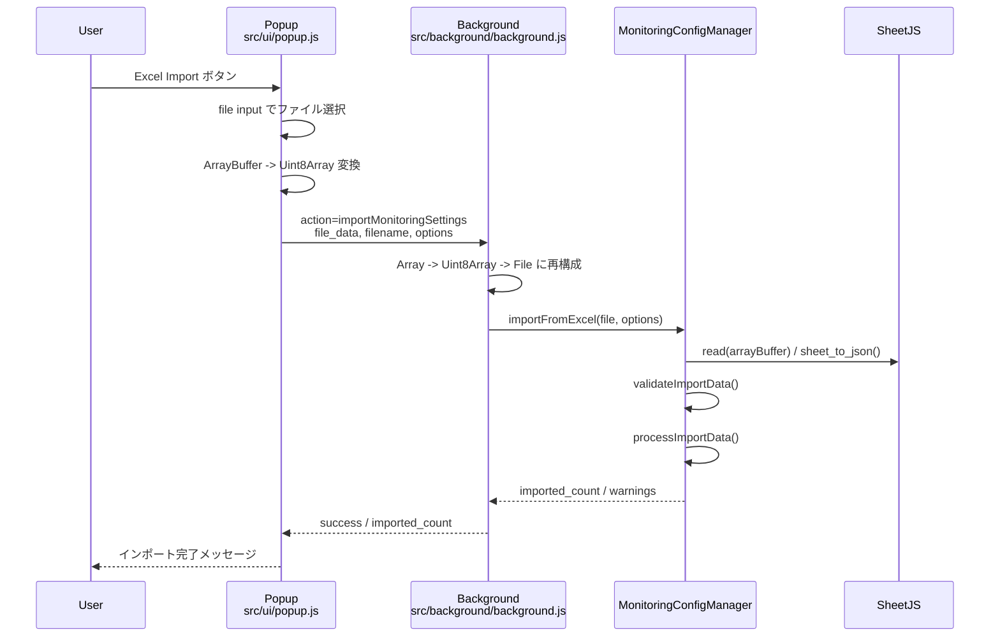

# Excel import / export フロー

複数監視設定の持ち運びに使う `exportMonitoringSettings` と `importMonitoringSettings` の流れです。

## エクスポート

```mermaid
sequenceDiagram
  participant U as User
  participant P as Popup<br/>src/ui/popup.js
  participant B as Background<br/>src/background/background.js
  participant M as MonitoringConfigManager
  participant X as SheetJS
  participant D as chrome.downloads

  U->>P: Excel Export ボタン
  P->>B: action=exportMonitoringSettings
  B->>M: exportToExcel('csv')
  M->>M: loadConfig()
  M->>X: json_to_sheet / write(bookType='csv')
  M-->>B: blob / filename / format
  B->>D: downloadWithFilename(data:text/csv;base64,...)
  B-->>P: download_method / filename / success
  P-->>U: ダウンロード開始メッセージ
```

## インポート


